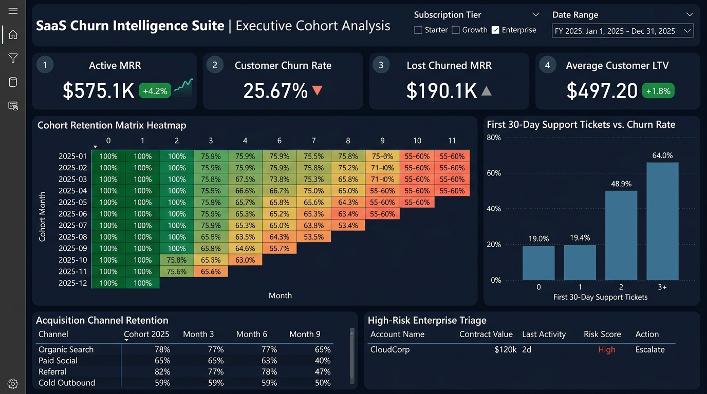
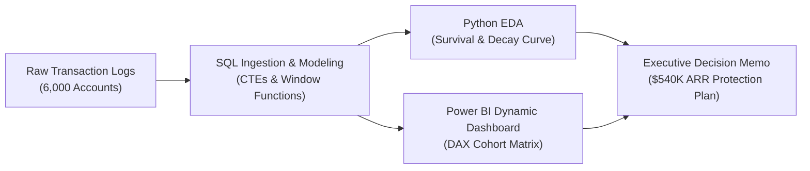

# SaaS Customer Churn & Cohort Retention Engine

[](#)
[](#)
[](#)
[](#)

> **Author:** [Shivastha Rewaskar](https://github.com/shivastharewaskar)  
> **Target Roles:** Data Analyst | Product Analyst | Business Analyst

---

## 📊 Interactive Power BI Dashboard UI


---

## Executive Overview
This project provides an end-to-end analytical framework to diagnose, quantify, and mitigate customer attrition for subscription businesses. By analyzing **6,000 customer accounts** and **$765K in Monthly Recurring Revenue (MRR)**, this study tracks monthly cohort survival decay, identifies behavioral churn triggers, and delivers actionable business strategies to safeguard enterprise revenue.



---

## The Business Problem
Subscription businesses frequently lose customers silently without clear visibility into **when** drop-offs occur or **which early behaviors** precede cancellation. 
* Total annual run-rate revenue lost to churn reached **$2,281,920**.
* Leadership lacked visibility into whether attrition was caused by product defects, pricing friction, or channel targeting errors.

---

## Key Analytical Insights

### 1. The "Two-Ticket" Onboarding Cliff
Customer attrition is strongly correlated with early customer friction:
* Accounts filing **0 to 1 support tickets** within 30 days of signup exhibit a low churn rate (~**19.2%**).
* Accounts filing **2 support tickets** experience an immediate jump to **48.93% churn**.
* Accounts filing **3 or more tickets** suffer **62.0% – 64.0% churn**.
* **45.32%** of all churned accounts explicitly reported *"Unresolved Technical Issues / Support Latency"* as their cancellation reason.

| 30-Day Support Tickets | Total Accounts | Churned Accounts | Churn Rate % | Lost MRR ($) |
| :---: | :---: | :---: | :---: | :---: |
| **0** | 3,045 | 579 | **19.01%** | $69,071 |
| **1** | 1,837 | 357 | **19.43%** | $42,893 |
| **2** | 703 | 344 | **48.93%** | $45,056 |
| **3** | 139 | 89 | **64.03%** | $9,411 |
| **4** | 145 | 90 | **62.07%** | $12,360 |
| **5** | 131 | 81 | **61.83%** | $11,369 |

### 2. Acquisition Channel Unit Economics
* **Paid Social:** Generated high acquisition volume but poor retention (**38.10% churn rate**, $71.7K MRR lost).
* **Referral:** Delivered the highest retention stability (**14.93% churn rate**, highest customer LTV).

---

## Technical Architecture & Repository Structure

```
├── data/
│   ├── generate_data.py               # Algorithmic synthetic subscription data generator
│   └── saas_subscriptions.csv         # 6,000 verified transaction records
├── sql/
│   ├── 01_schema_and_ingestion.sql    # DDL, indexes, and primary constraints
│   ├── 02_cohort_retention_analysis.sql # Advanced cohort matrix (CTEs, Window Functions)
│   └── 03_churn_drivers_and_segmentation.sql # Root cause analysis & account risk scoring
├── python/
│   └── churn_exploratory_analysis.py  # Standalone exploratory data analysis & statistical metrics
├── bi_dashboard/
│   ├── DAX_Measures.md                # 10+ production-grade DAX measures
│   └── Dashboard_Blueprint.md         # Wireframe specifications and layout rules
├── docs/
│   └── Executive_Decision_Memo.md     # C-suite briefing note with ROI calculations
└── README.md
```

---

## SQL Methodology Highlight: Cohort Retention Matrix
The monthly cohort retention matrix was computed using Common Table Expressions and date offsets:

```sql
WITH cohort_sizes AS (
    SELECT cohort_month, COUNT(DISTINCT customer_id) AS cohort_initial_users
    FROM subscriptions
    GROUP BY cohort_month
),
active_months AS (
    SELECT 
        b.cohort_month,
        b.customer_id,
        m.month_offset
    FROM subscriptions b
    CROSS JOIN (SELECT 0 AS month_offset UNION ALL SELECT 1 UNION ALL ... SELECT 11) m
    WHERE (b.cancellation_date IS NULL OR 
           (strftime('%Y', b.cancellation_date) * 12 + strftime('%m', b.cancellation_date)) - 
           (strftime('%Y', b.signup_date) * 12 + strftime('%m', b.signup_date)) > m.month_offset)
)
SELECT 
    a.cohort_month,
    cs.cohort_initial_users,
    a.month_offset,
    COUNT(DISTINCT a.customer_id) AS active_users,
    ROUND((COUNT(DISTINCT a.customer_id) * 100.0) / cs.cohort_initial_users, 2) AS retention_rate_pct
FROM active_months a
JOIN cohort_sizes cs ON a.cohort_month = cs.cohort_month
GROUP BY a.cohort_month, cs.cohort_initial_users, a.month_offset
ORDER BY a.cohort_month, a.month_offset;
```

---

## Strategic Recommendations
1. **Automated Escalation Rule:** Trigger immediate Senior Support intervention when any account opens their 2nd ticket within 30 days.
2. **Channel Budget Reallocation:** Reallocate 25% of Paid Social budget to high-intent Referral and Partner channels.
3. **Product Guided Tours:** Integrate interactive in-app onboarding to eliminate setup confusion.

---

## How to Run This Project
1. **Generate Dataset:**
   ```bash
   python data/generate_data.py
   ```
2. **Execute Python Analysis:**
   ```bash
   python python/churn_exploratory_analysis.py
   ```
3. **Execute SQL Queries:** Run the `.sql` scripts located in `/sql/` against PostgreSQL, MySQL, or SQLite.
